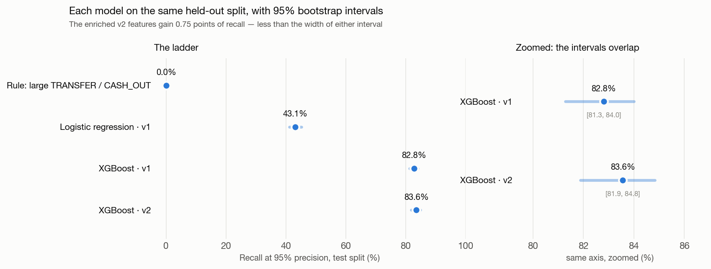
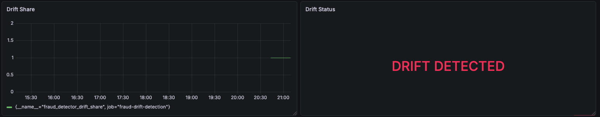
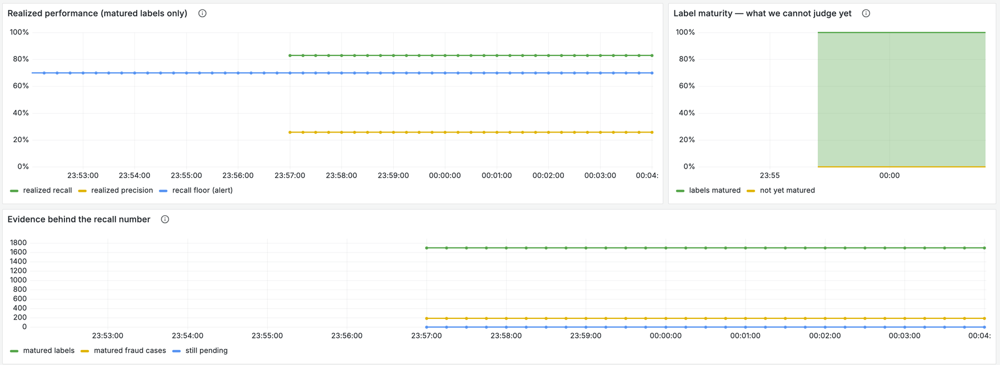
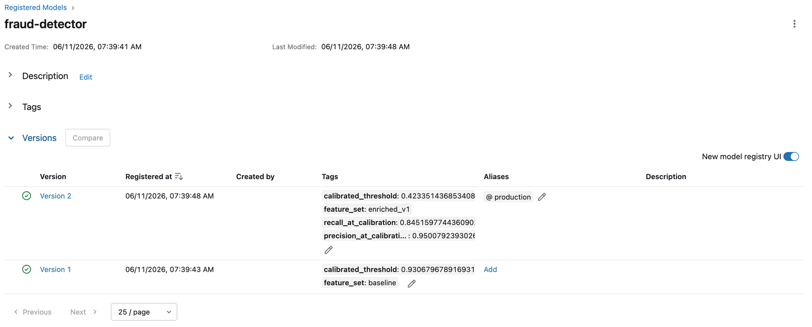
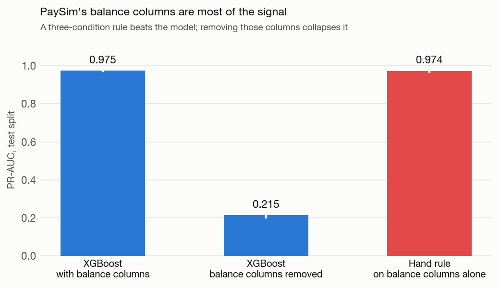
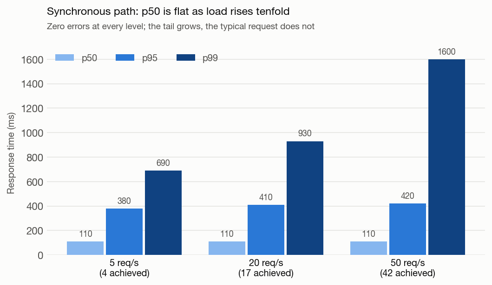

# Real-Time UPI Fraud Detection — MLOps Pipeline

[](https://github.com/pranav-j/payment_fraud_detection_mlops/actions/workflows/ci.yml)

An end-to-end MLOps pipeline that takes a fraud-detection model from notebook to a
production-shaped system on AWS: streaming inference, a feature store with
online/offline parity, drift monitoring with alerting, scheduled retraining, and the
entire cloud stack defined as infrastructure-as-code.

This is a portfolio project. It uses the public
[PaySim](https://www.kaggle.com/datasets/ealaxi/paysim1) dataset — synthetic
mobile-money transactions — as a stand-in for UPI payment data. The goal was not to
build the best possible fraud model. It was to build the *system around* a model the
way a real team would, and to be able to defend every architectural decision in an
interview.

---

## Results

- **0.975 PR-AUC**, **83.6% recall at 95% precision** (95% CI 81.9–84.8%), measured on
  the latest 389 simulated hours — 1,293,523 transactions, 4,258 of them fraudulent — with
  the threshold tuned on a separate earlier validation window, never on the test set.
- **110 ms p50** on the synchronous path at 42 req/s with zero errors, and **43.8 ms**
  warm Lambda duration on the streaming path — measured against the live stack, not
  estimated.
- **$0.15/hour** to run the whole stack, **$2.04/month** torn down, computed from live
  `ap-south-1` rates pulled from the AWS Price List API.
- **A three-condition hand rule beats every model here** — 97.4% recall at 100% precision —
  because PaySim generates fraud by emptying the origin account. That finding is in the
  [Evaluation](#evaluation) section rather than buried, and it is the most important thing
  to know about any result reported on PaySim.



Every number on this page traces to a file under [`reports/`](reports/), and every
figure is generated from those files by `make figures` — so the charts cannot drift
away from the text. Regenerate with `make evaluate`, `make cost`, `make figures`.

**Demo video:** *(not yet recorded — script and shot list in
[`docs/demo-video-script.md`](docs/demo-video-script.md))*
<!-- TODO: paste the link here once the video is cut. -->



*Drift detection firing during the injection run: `fraud_detector_drift_share`
reaches 1.0 — every monitored column drifted — after 200 transactions with
amounts roughly a thousand times normal were pushed through. Cropped as it
stood then; the provisioned dashboard now leads with realized performance
instead (see [Observability](#observability)).*



*The performance flow run against the real decision log — 1,700 decisions with
matured labels, 187 of them fraudulent. Realized recall 82.9% against the 70%
alert floor, and realized precision 25.9%: the model catches most fraud in this
traffic and raises a lot of false alarms doing it. The right-hand panel shows
100% of this window's labels have matured, so none of it is guesswork; the panel
exists because a window where that reads 0% cannot be judged at all.*



*The registry backing all of this. `@production` points at version 2, and the
threshold and calibration metrics the model is served with travel as tags on the
version itself — which is how the Lambda and the API both resolve a threshold
without anyone hardcoding one.*

---

## What this demonstrates

- Experiment tracking and a model registry with alias-based promotion (`@production`)
- Two serving patterns, each on the compute that fits it — event-driven streaming and
  synchronous request/response
- A feature store that enforces train/serve consistency, the failure mode that quietly
  breaks most real ML systems
- Scheduled orchestration: feature materialization, automated retraining behind a
  promotion gate, and drift detection
- Drift monitoring wired through to metrics dashboards and alerting
- The full AWS footprint as Terraform, with a verified teardown-and-rebuild cycle
- Architecture Decision Records (ADRs) capturing the *why* behind each choice — including
  the incidents and what they taught

---

## Architecture

```
                 PaySim dataset  (Kaggle · ~6.3M synthetic transactions)
                          |
            feature engineering  ->  XGBoost  ->  MLflow (tracking + registry)
                                                     |  metadata  -> RDS (Postgres)
                                                     |  artifacts -> S3
                                                     v
                                       models:/fraud-detector@production
                                                     |
              +--------------------------------------+-------------------------------+
              v                                                                      v
   STREAMING PATH  (production core)                        SYNCHRONOUS PATH  (HTTP exposure)
   producer -> Kinesis -> Lambda                            client -> ALB -> FastAPI on Fargate
                          |                                 returns the prediction in the response
                          | feature lookup -> Redis (Feast online store)
                          v
              decisions table (RDS) — append-only audit of every scored transaction
                          |
                          v
   MONITORING   Evidently drift check --> Prometheus --> Grafana
                                      \--> SNS --> email alert

   ORCHESTRATION (Prefect)    materialize · daily   |   retrain · weekly   |   drift · hourly
   FEATURE STORE (Feast)      offline = S3 parquet  |   online = Redis (EC2)
   INFRASTRUCTURE (Terraform) entire AWS stack as code · state in S3 · native S3 locking
```

### The three data stores


**S3** holds the big files: the trained model artifacts MLflow produces, the PaySim
parquet that Feast reads from, the Feast registry, drift-report HTML, and the Terraform
state. It is the durable filing cabinet — large, cheap, not fast.

**RDS (Postgres)** holds the structured records. Two distinct things live here: all of
MLflow's experiment and registry metadata (which runs happened, their metrics, and
crucially which model version carries the `@production` alias), and the `decisions`
table — an append-only audit log of every scored transaction.

**Redis (on EC2)** holds exactly one thing: the latest computed features for each repeat
sender, keyed by sender ID, for single-digit-millisecond lookups at inference time. Most
senders appear only once and have no history worth caching, so only the ~9,300 repeat
senders are materialized.

### Two serving paths, one model

The same registered model is served two ways, on the compute that fits each.

The **streaming path** is the production-shaped core. A producer pushes transactions into
a Kinesis stream; Lambda is triggered per batch, enriches each transaction with the
sender's historical features from Redis (via Feast), scores it, and writes the verdict to
the `decisions` table. Nothing waits on the result — it's fire-and-forget. This is the
path the rest of the system is built around: the audit log it populates is what
monitoring and retraining read from.

The **synchronous path** is how you would expose the same model for inline authorization,
where a caller needs a blocking yes/no before a payment completes. An HTTP request hits an
Application Load Balancer, which routes to a FastAPI container on ECS Fargate; the
prediction comes straight back in the response.

Both paths are real-time. They differ not in latency tier so much as in *who waits*: the
synchronous path blocks the caller for an answer, while the streaming path processes a
continuous flow with nobody waiting. Fargate is used for the synchronous path precisely
because a kept-warm container has no cold-start tail latency — the right instinct for an
inline gate — while Lambda fits the bursty, scale-to-zero streaming workload.

### Feature store and train/serve consistency

Fraud features like "transactions from this sender in the last 24 hours" can't be computed
from a single transaction in isolation — they need the sender's history. The danger is
computing those features one way in training and a different way at serving time;
that **train/serve skew** is a leading cause of silent production model failure.

Feast removes it by defining each feature once. The **offline store** (parquet in S3)
builds training data; the **online store** (Redis) serves it. A scheduled job materializes
features from offline to online. At inference time the streaming Lambda looks up the
sender's features from Redis and falls back to default zeros for first-time senders —
matching exactly what the model saw for first-time senders during training.

### Orchestration

Prefect runs three scheduled flows that close the loop:

- **Materialization** (daily) refreshes Redis from the S3 parquet so the online features
  don't go stale.
- **Retraining** (weekly) trains a fresh model, compares it to the current production
  model, and promotes only if it clears a gate — recall improvement of at least 2
  percentage points while holding precision at 95% or above. On its first real run the
  candidate was marginally worse and the gate correctly refused to promote it.
- **Drift detection** (hourly) bridges into monitoring.

### Monitoring and alerting

The drift flow pulls recent rows from the `decisions` table and compares their
distribution against the training baseline using **Evidently**. It writes a full HTML
report to S3, pushes the key drift metrics to **Prometheus** (via a Pushgateway, since the
flow is short-lived), which **Grafana** visualizes, and fires an **SNS** email alert when
drift crosses a threshold. The chain was verified end-to-end by injecting transactions
with amounts roughly a thousand times normal (`scripts/inject_drift.py` draws from a
lognormal with a median around 1.2M against normal traffic's 1.1K) — drift jumped to
100%, the dashboard lit up, and the alert
arrived.

### Infrastructure as code

The entire AWS footprint — VPC and security groups, RDS, the Redis EC2 instance, Kinesis,
Lambda, the ECS cluster and services, the ALB, IAM, Secrets Manager, SNS, CloudWatch — is
defined in Terraform. State lives in S3 with native S3 locking (`use_lockfile`), and
`prevent_destroy` guards the resources that hold data or images (S3, ECR). The full
destroy-and-rebuild cycle was exercised, not just `apply` — including recovering from a
self-inflicted RDS replacement and AWS's zombie-ENI behaviour, both documented in the ADRs.

### Networking and security

Everything on the data plane — the Lambda, the ECS tasks, the Redis EC2 instance, and
RDS — runs inside a VPC, and access between components is granted by **referencing
security groups, not by opening CIDR ranges**. The Lambda's security group is allowed into
the RDS and Redis security groups on only their service ports, so just the function can
reach the database and the cache; the data stores carry no `0.0.0.0/0` ingress. The ALB
sits in its own security group exposing only the HTTP listener.

Because the Lambda runs inside the VPC, it reaches S3 through an **S3 VPC Gateway
Endpoint** rather than the public internet — keeping that traffic on the AWS backbone and
avoiding the hourly cost of a NAT Gateway, the usual way VPC-bound compute reaches AWS
services. The RDS connection URI is held in **Secrets Manager** and injected at runtime,
never baked into an image or a task definition.

Two production gaps (both in the limitations below): RDS is left publicly accessible — with
only the developer IP allowed in its security group — for convenience during the build, and
the ALB serves plain HTTP rather than TLS.

---

## The model

XGBoost classifier on PaySim, with the decision threshold calibrated to maximise recall
subject to a precision floor (fraud is ~0.13% of transactions, so the threshold matters
far more than raw accuracy). The registered versions are:

| Registry version | Feature set | Threshold | Tagged recall | Tagged precision |
|---|---|---|---|---|
| v1 | baseline | 0.9307 | 80.4% | 95.0% |
| v2 (`@production`) | enriched (Feast historical features) | 0.4234 | 84.5% | 95.0% |

Confirmed against the live RDS-backed registry on 2026-10-19; the API served
`model_version: 2` through the ALB. (A stale local SQLite store on the dev
machine has a third version and points `@production` at it — the cloud registry
is the one that counts.)

Those are the tags carried on the model versions themselves, and they are **not** the
numbers to judge the model by. They came from a protocol that tuned the threshold on the
test set and reported no interval. The [Evaluation](#evaluation) section below has
numbers from a protocol that doesn't do that, and they are lower.

> **An earlier version of this README quoted "v1 80.4% → v2 84.5% recall" and called that
> jump "the entire justification for the feature store".** Re-measured properly — split by
> time on whole steps, threshold tuned on a validation split, bootstrap intervals — the
> enriched features improve PR-AUC by a clear margin (0.9523 → 0.9752, intervals don't
> overlap) but improve recall at 95% precision by 0.75 points, with intervals that overlap
> almost entirely. At the deployed threshold the two feature sets are indistinguishable.
> The feature store earns its place in this project as infrastructure — it is what makes
> train/serve consistency enforceable — but the recall claim did not survive the
> measurement, so it is gone.

---

## Evaluation

Every number here comes from [`reports/metrics/evaluation.json`](reports/metrics/evaluation.json),
regenerated by `make evaluate` from a committed script. The readable version with full
detail is [`reports/metrics/evaluation.md`](reports/metrics/evaluation.md). The protocol
is ADR-021.

### How the data is split

PaySim's `step` is a simulated hour, so the split is by time: train on the earliest
hours, validate on the next block, test on the latest. Boundaries land between whole
steps, so no simulated hour is divided across two splits.

| Split | Rows | Steps | Fraud | Fraud rate |
|---|---:|---|---:|---:|
| train | 3,820,599 | 1–281 | 3,193 | 0.0836% |
| validation | 1,248,498 | 282–354 | 762 | 0.0610% |
| test | 1,293,523 | 355–743 | 4,258 | 0.3292% |

The row counts and the step ranges disagree wildly, and that is the data rather than a
bug: PaySim's volume is heavily front-loaded, so 60% of rows is barely a third of the
hours. The fraud rate differs by 5x between validation and test for the same reason,
which matters below.

**The threshold is tuned on validation only.** The previous protocol tuned it on the
test set, which inflates the reported recall for a threshold nobody could have chosen in
advance.

### Baselines

All on the test split, which nothing was tuned on. Intervals are percentile bootstraps,
1,000 resamples.

| Model | PR-AUC [95% CI] | Recall @95% precision [95% CI] | Precision @ threshold | Recall @ threshold |
|---|---|---|---:|---:|
| Rule: large TRANSFER/CASH_OUT | 0.0831 [0.0755, 0.0920] | 0.0% [0.0%, 0.0%] | 19.5% | 11.2% |
| Logistic regression (v1 features) | 0.6677 [0.6545, 0.6806] | 43.1% [41.2%, 45.2%] | 99.7% | 35.4% |
| XGBoost (v1 features) | 0.9523 [0.9478, 0.9563] | 82.8% [81.3%, 84.0%] | 99.4% | 74.4% |
| XGBoost (v2 features) | 0.9752 [0.9728, 0.9777] | 83.6% [81.9%, 84.8%] | 99.3% | 74.3% |

Two columns, because "recall at 95% precision" is ambiguous and the difference is the
interesting part. **Recall @95% precision** is the best the ranking could do on test at
that precision floor — an upper bound found with hindsight. **Recall @ threshold** is
what the validation-tuned cut-off actually delivers. The ~9-point gap is the cost of
choosing a threshold before seeing the future: the validation window has a much lower
fraud rate than the test window, so the threshold comes out conservative and buys 99.3%
precision where only 95% was asked for.

**What the enriched features are worth.** v1 → v2 improves PR-AUC from 0.9523 to 0.9752
with non-overlapping intervals, so the ranking is genuinely better. Recall at 95%
precision improves by 0.75 points with intervals that overlap almost completely, and at
the deployed threshold v2 is a tenth of a point *behind*. The feature store is justified
here by train/serve consistency, not by a recall number.

**What a random split would have told you.** Run with a stratified random split instead,
the same v2 configuration reports 88.7% recall at 95% precision
against 83.6% on the time split — five points of pure
optimism from letting the model train on the future. `flows/retrain_model.py` still uses
a random split; that is a known gap, recorded rather than quietly fixed.

### Leakage

Excluded from every feature set:

| Column | Why |
|---|---|
| `isFlaggedFraud` | PaySim's own rule (transfers over 200,000). It is the simulator's output, not an observable input. |
| `nameOrig` | Sender account ID — used to *group by* when computing history, never as a feature. 6.3M near-unique values would be memorised, not learned. |
| `nameDest` | Destination account ID. Same reasoning. |

**The balance columns are kept, and they are the problem.** PaySim generates fraud by
emptying the origin account, so the balance columns don't correlate with the label —
they encode the generator's rule:

| Configuration | PR-AUC [95% CI] | Recall @95% precision [95% CI] |
|---|---|---|
| XGBoost (v2 features) | 0.9752 [0.9728, 0.9777] | 83.6% [81.9%, 84.8%] |
| XGBoost (v2 features, balance columns removed) | 0.2146 [0.2023, 0.2263] | 16.8% [15.5%, 18.2%] |
| Rule: PaySim balance signature | 0.9738 [0.9689, 0.9786] | 97.4% [96.9%, 97.8%] |



A three-condition rule anyone could write in a minute — a TRANSFER or CASH_OUT moving
exactly the origin account's whole balance, leaving it at zero — matches
**8,024 of 8,213 frauds (97.7%)** and
**1 of 6,354,407 legitimate transactions**. It beats
every trained model in the table. Strip those six columns out and the production
configuration falls from 0.975 PR-AUC to 0.215.

So the honest reading of every headline number on this page is: *this is what a model
scores on a simulator whose fraud rule is nearly deterministic.* Real payment data has
no column that clean. The no-balance row is the better guide to what the system would do
on real transactions, and the gap between the two is the single most important thing to
know about results on PaySim.

---

## Labels and performance monitoring

Drift detection answers *"has the input data changed?"*. It cannot answer *"is
the model still right?"* — and those come apart in exactly the case that
matters. A fraud pattern that shifts *within* the existing input distribution
looks ordinary by construction: that is what adapting to a deployed model means.
Drift stays flat and recall collapses.

Measuring recall needs outcomes, and outcomes are late. A fraud label is a
chargeback or a dispute: it arrives days to weeks after the transaction. So the
label delay is modelled explicitly rather than wished away.

### Two tables, because "true" and "known" are different things

| Table | What it holds |
|---|---|
| `ground_truth` | What the simulator knows, written by the producer at send time. Never reaches the scorer. |
| `labels` | What the business has been *told*, with an explicit `label_available_at`. |

`scripts/replay_labels.py` moves rows from the first to the second once
`LABEL_DELAY_HOURS` have elapsed since the decision, stamping maturity as
`scored_at + delay` so the result is the same whether it runs every minute or
once a day.

The split is the design: the performance flow can only read `labels`, and only
rows whose `label_available_at` has passed. It is structurally unable to see an
outcome earlier than the business would have.

**Two clocks.** PaySim's `step` is a *simulated* hour — a column in a static
file that never advances in real time. The replay runs on wall-clock time, so
`LABEL_DELAY_HOURS` is real hours since the decision: `0.05` (three minutes) for
a demo, `720` (thirty days) for a realistic chargeback window.

### The daily flow

`flows/monitor_performance.py` joins matured labels to decisions, computes
realized precision and recall per 24-hour window, pushes to Prometheus and
alerts via SNS. Daily rather than hourly, because labels arrive on the order of
days.

Two things it deliberately refuses to do:

- **A window with no matured labels reports `None`, not `0.0`.** Zero recall and
  "nothing to measure yet" are different states, and the newest window is always
  the second one.
- **An alert needs evidence.** At least 50 matured labels and 10 matured fraud
  cases before realized recall can fire an alert. Recall over three positives
  moves 33 points per case; alerting on that trains people to mute the alert.

The Grafana dashboard leads with realized precision and recall, with a
"labels not yet matured" panel beside it, so the blind spot is visible rather
than implied by a flat line.

### The demo: a shift that drift cannot see

```bash
python -m fraud_mlops.db migrate                   # create the tables
python scripts/demo_performance_drop.py --plan     # print the steps, send nothing
python scripts/demo_performance_drop.py            # run it
```

Three phases: normal traffic with PaySim-style fraud (the origin account is
emptied, which is the pattern the model learned); then fraud that takes small
amounts and leaves a balance behind; then the wait for labels to mature. Drift
stays flat throughout — the amounts involved look like ordinary traffic —
while realized recall collapses, but only *after* the delay has elapsed.

That lag is not a flaw in the implementation. It is the honest cost of
outcome-based monitoring, and it is the argument for keeping drift detection
rather than replacing it.

**Does the shift actually evade the model?** Yes, and it is asserted in the test
suite rather than assumed. Trained on PaySim's enriched feature set with the
threshold tuned on validation, the model flags:

| Traffic | Flagged |
|---|---:|
| normal | 0.2% |
| fraud, PaySim-style (origin emptied) | 79.2% |
| fraud, shifted (small amounts, balance left) | **0.0%** |

`tests/test_pipeline_smoke.py` re-derives this on a synthetic fixture, so if the
feature set ever changes in a way that closes the gap, CI says so.

> **The first live run of this demo, on 2026-10-19, was misread.** Decisions
> were attributed to phases by splitting on median `scored_at`, and the query
> window happened to include an unrelated producer run from 18 minutes earlier
> — so both "phases" were mixtures and the recall figures were meaningless.
> They are withdrawn in
> [`reports/perf/2026-10-19/demo_result.json`](reports/perf/2026-10-19/demo_result.json).
> The producer now writes the generator into `ground_truth.source` and the demo
> reports recall per generator, so phases are attributed exactly instead of
> guessed. The plumbing itself — producer, Lambda, ground truth, label replay,
> maturity join, windowing, alert rule — all ran correctly end to end on real
> infrastructure. A clean live run on an idle stack is still outstanding.

### How a promoted model actually reaches the serving paths

Worth being precise about, because "the registry has an alias" says nothing
about when traffic moves.

| Path | How it resolves `@production` | When a promotion takes effect |
|---|---|---|
| **Lambda** (streaming) | `load_production_detector()` at module import — once per container, during init | Within `MODEL_TTL_SECONDS` (default 900s). The handler re-resolves the alias when its cached model is older than the TTL. |
| **Fargate** (synchronous) | FastAPI lifespan hook — once per task start | Not until the service is redeployed: `aws ecs update-service --force-new-deployment`. Nothing triggers this automatically. |

Before the TTL existed, a warm Lambda container served whatever version it
resolved at cold start, indefinitely — AWS recycles containers on its own
schedule, so there was no bound at all, and the `decisions` audit log recorded
two model versions deciding concurrently with nothing to explain it. ADR-022
covers the options and why the retrain flow does not yet force a Lambda
configuration update, which would be the better production answer.

### What the retrain flow trains on

`flows/retrain_model.py` reads `data/interim/paysim_with_features.parquet` — a
static local file. It does not read the `decisions` table or any newer data, and
it splits randomly rather than by time. With a fixed seed on unchanging data,
each weekly run produces essentially the same model, so the 2-percentage-point
promotion gate refuses every time. The gate has never been exercised against a
genuinely better candidate.

This is documented rather than fixed: changing what the model trains on is a
modelling decision, and this round of work was about measurement.

---

## Observability

Three questions a system like this gets asked at 3am, and where the answer comes
from.

### "Is it still working?"

Metrics, pushed rather than scraped. The Prefect flows are short-lived — a run
that lasts ninety seconds is never up long enough for Prometheus to scrape it —
so they push to a Pushgateway that Prometheus scrapes instead. Grafana reads
Prometheus; `make monitoring-up` brings all three up with the datasource and the
dashboard already provisioned.

| Signal | Metric | Source |
|---|---|---|
| Input drift | `fraud_detector_drift_share`, `..._drifted_columns_count` | Evidently, hourly |
| Realized performance | `fraud_detector_realized_precision`, `..._realized_recall` | daily, matured labels only |
| Label maturity | `fraud_detector_label_maturity_share`, `..._pending_labels` | daily |
| Evidence weight | `fraud_detector_matured_labels`, `..._matured_positives` | daily |

The last two exist so a reader can tell "recall is fine" from "recall is unknown".
A dashboard that cannot distinguish those is worse than no dashboard.

### "Why did it decide *that*?"

Every scored transaction writes a row to `decisions` that is sufficient to
reconstruct the decision:

```
transaction_id  type  amount  is_fraud  probability  threshold
model_version  feature_set  ingested_at  scored_at  latency_ms
```

`model_version` and `threshold` travel with the decision rather than being looked
up later, so a decision made during a model rollout is still explainable after the
rollout finishes — which matters here, because the Lambda re-resolves `@production`
on a TTL and genuinely serves two versions side by side for a window (ADR-022).
The FastAPI response carries the same fields, for the same reason.

This is lineage rather than tracing: there is no span, no trace ID, and no
correlation across services. For a fire-and-forget path with one hop it has been
enough.

### "What blew up?"

CloudWatch log groups for the Lambda and both Fargate services, 7-day retention,
set in Terraform. `scripts/lambda_latency.py` reads the `REPORT` and `INIT_REPORT`
lines back out — which is how the init-timeout cold start in ADR-024 was found at
all.

### What is missing, honestly

- **No structured logging.** Log lines are human-readable strings, so answering
  "show me every decision for sender X" means grepping CloudWatch rather than
  querying. JSON lines with the transaction ID as a field would fix this and is
  the single highest-value change in this section.
- **No distributed tracing.** No OpenTelemetry, no trace IDs. One hop makes this
  survivable; a second service would not.
- **No alerting on the pipeline itself.** The alerts cover the *model* — drift and
  realized recall. Nothing pages anyone if the Lambda starts erroring, the Kinesis
  iterator age climbs, or a Prefect flow stops running. Those are CloudWatch alarms
  that do not exist yet, and their absence is the gap most likely to bite first:
  the model being wrong is monitored, the pipeline being *down* is not.
- **Dashboards are local.** Grafana runs on a laptop, so nobody is looking at it
  while the laptop is shut.

---

## Performance and cost

### Cost

From [`reports/cost/estimate.md`](reports/cost/estimate.md), generated by
`make cost` from rates `scripts/fetch_pricing.py` pulls out of the AWS Price
List API for `ap-south-1`. Rates are real; usage figures are assumptions, and
they are listed in the report.

| | Hourly | Monthly (730 h) |
|---|---:|---:|
| Stack running | $0.1543 | $112.61 |
| Idle, torn down | $0.00280 | $2.04 |

The four biggest hourly lines: Fargate tasks ($0.04358), Application Load Balancer ($0.03190), Public IPv4 addresses ($0.02500), RDS ($0.02100). The ALB has no stopped state, which is
why teardown rather than stop-start is the cost strategy here — and public IPv4
addresses, charged since February 2024, are a line most people forget.

Marginal cost per 1,000 predictions on the streaming path is
**$0.000339**. Fully loaded — the entire running
cost divided by throughput — it is **$0.0086**.
The gap is the point: at this scale the predictions are nearly free and the
infrastructure is not.

### Latency

Measured 2026-10-19 against the live stack in `ap-south-1`. Raw output is in
[`reports/perf/2026-10-19/`](reports/perf/2026-10-19/).

**Synchronous path** — Locust against the ALB, 2 minutes at each level, from a
laptop in India to Mumbai:

| Target | Achieved | p50 | p95 | p99 | Failures |
|---:|---:|---:|---:|---:|---:|
| 5 req/s | 4.4 | 110 ms | 380 ms | 690 ms | 0 |
| 20 req/s | 17.3 | 110 ms | 410 ms | 930 ms | 0 |
| 50 req/s | 42.1 | 110 ms | 420 ms | 1,600 ms | 0 |



No errors at any level, and p50 is flat at 110 ms across a tenfold increase in
load — the 0.5 vCPU task is nowhere near saturation. The load test also hits
`/health`, which has no model in it and came in at p50 100 ms. So of that
110 ms, roughly 100 ms is round-trip network and **the model contributes about
10 ms**. The growing p99 is the tail, not the typical request.

**Streaming path** — 1,200 transactions at 10/s through Kinesis and Lambda:

| Measurement | p50 | p95 | p99 |
|---|---:|---:|---:|
| Ingest to decision (Kinesis receipt → row committed) | 610 ms | 40.6 s | 67.5 s |
| Lambda duration, warm (825 invocations) | 43.8 ms | 58.0 ms | 130.2 ms |
| Lambda duration, cold (1 invocation) | 61.4 s | — | — |

The streaming tail is entirely the cold start. Warm, the function runs in
43.8 ms and the whole pipeline commits a decision in 610 ms.

**The cold start is worse than this project used to claim, and for an
interesting reason.** Lambda allows an initialisation phase 10 seconds. Loading
MLflow, resolving the `@production` alias, pulling the model artifact from S3
and opening the Feast registry takes longer, so the init phase *times out*:

```
INIT_REPORT Init Duration: 9999.64 ms  Phase: init  Status: timeout
```

Lambda then re-runs initialisation inside the first invocation, which is why
that invocation billed **61.4 seconds** and its `REPORT` line carries no
`Init Duration` at all. Any tool that identifies cold starts by looking for
`Init Duration` — including the first version of
[`scripts/lambda_latency.py`](scripts/lambda_latency.py) — reports zero cold
starts for exactly the functions with the worst ones. It now reads
`INIT_REPORT` lines too.

---

## Tech stack

| Concern | Tooling |
|---|---|
| Language / tooling | Python 3.12, `uv`, src-layout package |
| Modelling | XGBoost, scikit-learn |
| Tracking & registry | MLflow (RDS backend, S3 artifacts) |
| Streaming inference | AWS Kinesis + AWS Lambda (container image, arm64) |
| Synchronous inference | FastAPI on ECS Fargate, behind an ALB |
| Feature store | Feast (S3 offline + registry, Redis online) |
| Orchestration | Prefect (three scheduled flows) |
| Monitoring & alerting | Evidently, Prometheus, Grafana, SNS |
| Data / audit stores | S3, RDS Postgres, Redis (EC2) |
| Infrastructure | Terraform (S3 state, native S3 locking) |
| Packaging | Docker, ECR |
| Code quality | ruff, nbstripout, detect-secrets (pre-commit) |

---

## Repository layout

```
payment_fraud_detection_mlops/
├── notebooks/          # EDA, baseline model, feature engineering (thin — they call src/)
├── src/fraud_mlops/    # importable package: features, training, promotion gate,
│                       #   evaluation, performance monitoring, cost, db (logic lives here)
├── lambda/             # streaming scorer: handler, Dockerfile, pinned requirements
├── feature_repo/       # Feast: entities, features, data sources, feature_store.yaml
├── flows/              # Prefect: materialize, retrain, detect_drift, monitor_performance
├── migrations/         # numbered SQL — decisions, labels, latency columns
├── monitoring/         # Prometheus config, provisioned Grafana datasource + dashboard
├── load_test/          # Locust file for the /predict endpoint
├── infra/              # Terraform for the full AWS stack (+ ECS task defs)
├── scripts/            # producer, label replay, latency pullers, pricing, demo, session runner
├── reports/            # generated: metrics/, cost/, perf/, figures/ — every number lives here
├── tests/              # pytest suite
├── docs/adr/           # Architecture Decision Records (decisions.md)
├── .github/workflows/  # CI: lint, test, terraform, arm64 image builds
├── Dockerfile.*        # FastAPI and MLflow images
├── docker-compose*.yml # local stacks
├── Makefile            # task runner
└── pyproject.toml      # uv-managed project config
```

The guiding principle: **logic lives in `src/`, not in notebooks.** Notebooks are thin
wrappers that call into modules, which is what made promoting code into Prefect flows and
the Lambda handler straightforward.

---

## Running it

### Prerequisites

- [`uv`](https://docs.astral.sh/uv/) for Python dependency management
- Docker (for building the Lambda / FastAPI / MLflow images)
- An AWS account with the CLI configured (`ap-south-1` in this build)
- Terraform for provisioning the cloud stack

### Local development

```bash
# install runtime + dev dependencies and pre-commit hooks
make install-dev

# configure environment (RDS, Redis, S3, MLflow URIs)
cp .env.example .env        # then fill in values

# download the PaySim dataset
make data

# explore / train
make notebook               # 01_eda → 02_baseline_model → 03_feature_engineering

# quality
make lint        # ruff + type checks
make test        # pytest
```

Most commands that touch AWS expect the environment to be loaded first:

```bash
set -a && source .env && set +a
```

### Provisioning the AWS stack

```bash
cd infra
terraform init
terraform apply          # review the plan before approving
```

After the stack is up, the data-plane is initialised by starting the MLflow server
(`scripts/run_mlflow_server.sh`), registering the model, materialising features into Redis
(`feast -c feature_repo materialize ...`), and deploying the Prefect flows
(`flows/deploy.py`). The streaming path can then be exercised end-to-end with
`scripts/produce_transactions.py`.

> **Note on cost:** stateful and billable resources (RDS, the Redis EC2 instance, the ALB,
> Kinesis) are destroyed between sessions. Running, the stack costs
> **$0.1543/hour**; torn down, **$2.04/month** for S3, ECR,
> Secrets Manager and CloudWatch. The ALB has no "stopped" state, which is why teardown
> rather than stop-start is the strategy. Both figures come from
> [`reports/cost/estimate.md`](reports/cost/estimate.md).

---

## Known limitations & what production would change

This is a learning project on synthetic data, and several choices were deliberate scope
decisions rather than what a real deployment would do:

- **The two serving paths are partly redundant here.** Both score the same model; the
  streaming path is the integrated core (it writes the decisions audit log that monitoring
  and retraining consume), while the synchronous FastAPI path is a demonstration of the
  request/response pattern and does not itself persist decisions. In production these would
  serve genuinely different functions — an inline authorization gate versus a
  near-real-time monitoring and feature-maintenance layer.
- **Kinesis runs a single shard.** Fine for the project's volume. At scale you would add
  shards and, more importantly, move windowed velocity-feature computation to a stateful
  stream processor (e.g. Apache Flink), which Lambda doesn't do natively.
- **Prefect and the monitoring stack run locally.** The flows and Prometheus/Grafana
  execute on a developer machine and reach out to AWS; production would host them on
  always-on infrastructure so schedules fire without a laptop. The monitoring side is at
  least reproducible now — `make monitoring-up` brings up Prometheus, the Pushgateway and
  Grafana with the datasource and dashboard provisioned, where previously it existed only
  as containers somebody had started by hand.
- **Lambda cold start is 61 seconds, not the ~24s previously claimed.** Measured
  2026-10-19. The init phase times out at Lambda's 10-second limit and the work restarts
  inside the first invocation (see [Performance and cost](#performance-and-cost)).
  Acceptable only because the streaming path is fire-and-forget; a latency-sensitive path
  would need provisioned concurrency, or a smaller init — loading the model from a baked-in
  artifact rather than resolving it through MLflow at startup would be the first thing to
  try.
- **No TLS on the ALB.** Acceptable for synthetic data with no PII; production would add an
  ACM certificate and an HTTPS listener (no application code changes required).
- **RDS is publicly accessible.** Convenient for connecting from a laptop during the build,
  with only the developer IP allowed in its security group; production would keep it in
  private subnets and reach it through a bastion or VPN.
- **Single-AZ RDS, no Multi-AZ.** A zone failure would take the backend offline. A
  production deployment would enable Multi-AZ.
- **PaySim's balance columns make the task close to deterministic.** A three-condition
  hand rule on them beats every trained model here. The model is kept as-is and the
  comparison published, because the honest version of any PaySim result is "this is what
  a model scores on a simulator whose fraud rule is nearly deterministic". See
  [Evaluation](#evaluation).
- **The retrain flow trains on a static file and splits randomly.** It reads
  `data/interim/paysim_with_features.parquet` rather than anything newer, with a fixed
  seed, so each weekly run produces essentially the same model and the promotion gate
  refuses every time. The gate has never been exercised against a genuinely better
  candidate. Fixing this means deciding what the model should train on, which is a
  modelling decision rather than a measurement one.
- **A promoted model reaches Fargate only on redeploy.** The Lambda re-resolves the
  `@production` alias within `MODEL_TTL_SECONDS`; the API does not re-resolve at all
  until its task restarts. ADR-022 covers why the retrain flow does not yet force the
  update itself.
- **Outcome monitoring lags by the label delay.** Realized recall cannot see a
  degradation until labels mature — weeks, in production. That is intrinsic, not an
  implementation gap, and it is the argument for keeping data-drift detection alongside
  it rather than replacing it.
- **No latency measurements yet.** The instrumentation is in place; the AWS session that
  produces the numbers has not been run.

Naming these is the point: the project is a faithful miniature of a real system, and the
gaps are understood rather than hidden.

---

## Architecture decision records

Every significant choice — and several instructive failures — is recorded in
[`docs/adr/decisions.md`](docs/adr/decisions.md). A few worth highlighting:

- **Cloud-native state (ADR-013):** why model artifacts and registry metadata had to live
  in S3 + RDS rather than on any one machine's filesystem, so the same
  `models:/fraud-detector@production` resolves identically from a laptop, Fargate, or
  Lambda.
- **Feast registry on S3, not SQL (ADR-016):** the SQL registry caused per-invocation
  Postgres connection timeouts from Lambda; an S3 file registry fixed it. Also covers the
  train/serve consistency design.
- **Terraform IaC (ADR-019):** adopting IaC on an existing stack — including the incident
  where an `apply` on an imported resource replaced (destroyed) the production RDS, and
  the zombie Lambda ENIs that blocked a security-group deletion. The lesson —
  `terraform plan | grep destroy` before every apply on imported resources — is the kind
  of scar that only comes from doing it.
- **Evaluation protocol (ADR-021):** what was wrong with the original numbers, which
  direction each flaw biased them, and why the replacement numbers are lower.
- **Model rollout (ADR-022):** a registry alias is only as useful as the thing that
  propagates it. Where this system is eventually consistent, with what bound, and what
  it would take to make it immediate.
- **Delayed labels (ADR-023):** why "monitor your model" is two different jobs, why the
  second one is gated on label latency, and why the delay belongs in the schema rather
  than in a caveat.
- **Cold start (ADR-024):** the Lambda's init phase times out against AWS's 10-second
  limit, so initialisation restarts inside the first invocation — 61 seconds billed, and
  no `Init Duration` field to show for it. Why the fix is a smaller init rather than
  provisioned concurrency.

---

## License

MIT
